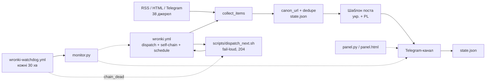

# Wronki-News-Bot — архітектура

- Джерела: 38 увімкнених у радіусі 30 км; Facebook/Instagram — HTML-сторінки,
  їхня фактична віддача не перевірялася.
- `state.json` — 201 URL; дедуплікація перед публікацією.
- Секрети: `TELEGRAM_BOT_TOKEN`, `GH_PAT` — у GitHub Secrets, не в git.
- `wronki.yml` (локально, 26.10): `workflow_dispatch` + самоланцюжок через
  `dispatch_next.sh` + страховий `schedule: */10`. `wronki-watchdog.yml` запускає
  `monitor.py` (успішний прогін ≤ 3 год, dispatch-прогін ≤ 30 хв, пост ≤ 24 год) і
  піднімає ланцюжок. У GitHub це з'явиться лише після пушу власником (scope `workflow`).
