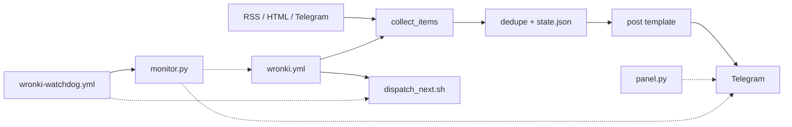

# Wronki-News-Bot — System Map

## Модулі

| Модуль | Відповідальність | Залежить від |
|---|---|---|
| `bot.py` | збір, фільтр, переклад, публікація | `config.json`, `state.json` |
| `monitor.py` | вік успішного прогону, живість ланцюжка, вік поста, алерт | GitHub API, `t.me`, Telegram API |
| `panel.py/html` | локальна панель: config, запуск, тест | `bot.py`, GitHub API |
| `config.json` | 38 джерел, радіус, ліміти | — |
| `state.json` | історія URL і заголовків (201 / 390) | fs |
| `content/` | план і готові пости | — |
| `.github/workflows/wronki.yml` | dispatch + self-chain + schedule | `bot.py`, `dispatch_next.sh`, `GH_PAT` |
| `.github/workflows/wronki-watchdog.yml` | сторож кожні 30 хв (локально, чекає пушу) | `monitor.py`, `dispatch_next.sh`, `GITHUB_TOKEN`, `GH_PAT` |
| `scripts/dispatch_next.sh` | dispatch наступного прогону, fail-loud | GitHub API, `GH_PAT`, `jq` |

## Заборонені зв'язки

- Пости → без джерела.
- Панель → публікація без підтвердження.
- Workflow → inline `curl` (лише `dispatch_next.sh`; перевіряється тестом).
- Пуш `.github/workflows/*` → лише власником, токеном зі scope `workflow`.
- `monitor.py` → алерт у сам канал (лише окремий chat_id).
